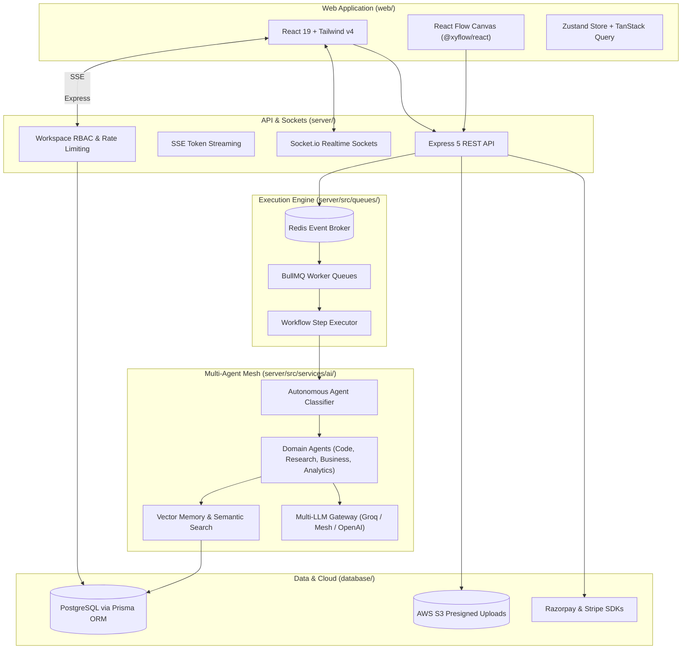

<div align="center">

# Cognify

### Enterprise AI Operations & Multi-Agent Orchestration Platform

Cognify is an open-source, full-stack AI Operations platform designed for technical teams to build, simulate, and execute multi-agent pipelines visually. Featuring a custom drag-and-drop workspace canvas, autonomous agent registries, vector memory search, team collaboration threads, and integrated billing checkouts.

---

[](.github/workflows/ci.yml)
[](https://nodejs.org)
[](https://react.dev)
[](https://www.typescriptlang.org)
[](https://www.postgresql.org)
[](https://www.prisma.io)
[](https://tailwindcss.com)
[](https://bullmq.io)
[](https://opensource.org/licenses/Apache-2.0)

[**Features**](#key-features) •
[**Architecture**](#architecture) •
[**Quickstart**](#quickstart) •
[**Documentation**](#documentation) •
[**Deployment**](#production-deployment) •
[**Contributing**](CONTRIBUTING.md)

</div>

---

## Architecture

Cognify employs an **Exposed Top-Level Architecture** separating presentation, server compute, database models, containers, and orchestration:



---

## Key Features

### 1. Visual Workflow Graph Builder & Live Telemetry
* **Interactive Canvas**: Drag-and-drop editor powered by `@xyflow/react` (React Flow) with custom nodes for Triggers, AI Agents, Conditions, Transforms, and Actions.
* **Auto-Layout Grid**: Automatically organizes complex cyclic and branching pipelines via Dagre layout algorithms.
* **Live Execution Telemetry**: Real-time node overlays via Socket.io streaming, per-node latencies ($ms$), execution status badges, and step-level input/output inspection.
* **Prebuilt Seeded Workflows**: Out-of-the-box "golden" workflows for Support Ticket Triage, Grounded RAG Research Pipeline, and Automated Code PR Reviewer with 10,000 seeded credits.

### 2. Isolated BullMQ Queues & Step-Level Replay
* **Dedicated Execution Pools**: Dedicated `workflow-exec` (concurrency: 5) and `doc-ingest` (concurrency: 2) queues to eliminate head-of-line blocking between fast workflows and heavy document processing.
* **Dead-Letter Handling (DLQ)**: Configured with 3 retry attempts, exponential backoff, and failure retention in Redis for post-mortem analysis.
* **Step-Level Replay Cache**: Granular `RunStep` state machine (`PENDING -> RUNNING -> COMPLETED | SKIPPED`). Retrying failed runs bypasses upstream LLM nodes, saving over 75% in redundant token costs.

### 3. Hybrid pgvector + tsvector RAG with SQL Tenant Isolation
* **Unified PostgreSQL Storage**: 1536-dimensional vector embeddings co-located in the primary database—eliminating dual-write synchronization drift and external vector DB costs.
* **Reciprocal Rank Fusion (RRF)**: Merges dense cosine similarity (`pgvector` `<=>`) with sparse lexical full-text search (`tsvector` + `plainto_tsquery`) using $k=60$.
* **SQL-Enforced Multi-Tenancy**: Strict `WHERE workspace_id = $workspaceId` boundary enforced at the SQL planner level, preventing cross-workspace leakage.
* **Prompt-Injection Boundary**: Sanitizes untrusted document chunks, strips spoofed XML tags, and enforces non-override system grounding directives.

### 4. AES-256-GCM Integration Vault
* **Authenticated Encryption**: Secures third-party API tokens and secrets (Slack, Notion, S3) using AES-256-GCM with unique 12-byte random IVs per call.
* **Tamper Detection**: Validates ciphertext integrity via 128-bit authentication tags, rejecting corrupted payloads before decryption.
* **Safe Client Masking**: Displays masked hints (`••••••••abcd`) in client UIs without leaking secrets.

### 5. Append-Only Credit Ledger & Webhook Idempotency
* **O(1) Atomic Balance Updates**: Eliminates $O(N)$ table scans with atomic conditional balance updates (`UPDATE workspaces SET credit_balance = credit_balance - $amount WHERE id = $1 AND credit_balance >= $amount RETURNING credit_balance`) paired with an immutable append-only `CreditLedger` audit trail.
* **Mathematical Drift-Free Accounting**: Derives balances immutably while maintaining audit integrity across hold reservations, commits, and refunds.
* **P2002 Webhook Deduplication**: Ingests Stripe and Razorpay webhooks with PostgreSQL unique constraint deduplication, safely ignoring gateway retries (`deduplicated: true`).
* **Constant-Time Verification**: Verifies payment gateway signatures using `crypto.timingSafeEqual` to thwart timing attacks.

### 6. Production Operations & Redis Lua Rate Limiting
* **Atomic Redis Lua Rate Limiter**: High-throughput sliding-window log rate limiting executed atomically in Redis via Lua (`ZREMRANGEBYSCORE` + `ZCARD` + `ZADD`) to prevent cluster race conditions.
* **Horizontal Scaling & Process Role Splitting**: Decouples API instances from background workers via `SERVICE_ROLE=api|worker|all` and scales multi-pod Socket.io fan-out via `@socket.io/redis-adapter`.
* **Queue-Depth Backpressure & Load Shedding**: Sheds burst workflow requests with HTTP 503 and `Retry-After: 30` when BullMQ queue depth exceeds `MAX_QUEUE_DEPTH`.
* **LLM Circuit Breaker & Automatic Failover**: Deterministic state machine (`CLOSED` -> `OPEN` -> `HALF_OPEN`) in `LLMGateway` preventing hung sockets with automatic failover across Groq, Mesh, and OpenAI.
* **PM2 Zero-Downtime Clustering**: Smooth cluster reloads scaling backend instances across all available CPU cores.
* **Observability & Error Tracking**: Sentry SDK integration capturing middleware exceptions, accompanied by Winston structured logs.
* **Automated CI Test Suite**: 35-test verification suite across 8 suites covering topological graph ordering, cryptographic vault encryption, prompt-injection defense, webhook deduplication, LLM circuit breakers, O(1) credit ledger mechanics, and distributed sequence numbers running in GitHub Actions CI.

---

## Repository Structure

Cognify brings core modules directly to the top level for immediate accessibility on GitHub:

```text
cognify/
├── .github/                   # GitHub Actions CI/CD workflows and PR templates
│   └── workflows/ci.yml       # Automated install, lint, and build validation
│
├── web/                       # Frontend SPA (React 19, TypeScript, Vite, Tailwind v4)
│   ├── src/
│   │   ├── components/        # UI primitives, marketing sections, and visual widgets
│   │   ├── constants/         # Pricing tiers, feature definitions, FAQs
│   │   ├── context/           # Theme and global state providers
│   │   ├── hooks/             # Custom lifecycle and typewriter hooks
│   │   ├── icons/             # Bento, illustration, and card SVG collections
│   │   ├── lib/               # Utility functions (cn, SEO helpers, blog metadata)
│   │   ├── pages/             # Dashboard cockpit and public marketing pages
│   │   ├── config.ts          # Cognify site metadata
│   │   ├── App.tsx            # Main router
│   │   └── main.tsx           # Client entrypoint
│   ├── vite.config.ts         # Vite bundler with @/ path alias
│   └── package.json           # @cognify/web
│
├── server/                    # Backend API & Realtime Worker Engine (Express 5, Node.js)
│   ├── src/
│   │   ├── config/            # DB client, Redis, logger, env validation
│   │   ├── middleware/        # JWT auth, workspace RBAC, rate limiting, Sentry
│   │   ├── queues/            # BullMQ task queues & execution workers
│   │   ├── routes/            # 15+ REST API modules
│   │   ├── services/          # Multi-agent orchestrator, vector memory, storage, integrations
│   │   ├── sockets/           # Real-time Socket.io chat handlers
│   │   ├── app.ts             # Express middleware stack
│   │   └── server.ts          # Server listener & socket registration
│   ├── tests/                 # 35-test unit & verification suite (node:test + tsx)
│   ├── ecosystem.config.js    # PM2 cluster configuration
│   └── package.json           # @cognify/server
│
├── database/                  # PostgreSQL Models & Prisma ORM
│   ├── schema.prisma          # PostgreSQL models (Users, Workspaces, Files, Embeddings, Workflows)
│   ├── migrations/            # Version-controlled migration history
│   ├── indexes.sql            # Production pgvector HNSW & GIN full-text indexes
│   └── seed.ts                # Database seeding script for development
│
├── docker/                    # Container Orchestration
│   ├── docker-compose.yml     # Multi-container stack (Postgres, Redis, Server, Web)
│   ├── Dockerfile.server      # Multi-stage backend container definition
│   └── Dockerfile.web         # Nginx-based frontend container definition
│
├── docs/                      # Technical Documentation & Diagrams
│   ├── adr/                   # Architecture Decision Records (ADRs 001-003)
│   ├── ARCHITECTURE.md        # System architecture, data flow, microservices
│   ├── AGENTS.md              # Autonomous agent engine, specialized personas, vector memory
│   ├── WORKFLOWS.md           # Graph canvas model, step executor, and BullMQ worker
│   └── API.md                 # REST endpoints, SSE streams, and WebSocket events
│
├── scripts/                   # Developer Automation Scripts
│   ├── dev.sh                 # Environment initialization and dev launcher
│   ├── seed.sh                # Automated database seeder
│   ├── deploy.sh              # Zero-downtime production deployment script
│   └── loadtest.js            # k6 concurrency & backpressure load test suite
│
├── .editorconfig              # Uniform code formatting rules
├── .env.example               # Full-stack environment variable reference
├── CONTRIBUTING.md            # Contributor guidelines and PR standards
├── docker-compose.yml         # Root Docker Compose configuration
├── package.json               # Root monorepo workspace configuration
└── render.yaml                # Render cloud deployment blueprint
```

---

## Tech Stack

| Domain | Technology | Purpose |
| :--- | :--- | :--- |
| **Frontend Framework** | **React 19** + **TypeScript** | Core component runtime |
| **Build Tool** | **Vite 8** | Fast HMR and bundle compilation |
| **Canvas & Graph** | **`@xyflow/react`** + **`dagre`** | Visual node graph and auto-layout |
| **Styling & UI** | **Tailwind CSS v4** + **Motion** | Fluid styling and physics-based animations |
| **Backend Framework** | **Express 5** + **TypeScript** | Core REST & streaming server |
| **Database & ORM** | **PostgreSQL** + **Prisma ORM** | Schema migrations and relation queries |
| **Asynchronous Queue** | **BullMQ** + **Redis 7** | Reliable background workflow task queues |
| **Realtime** | **Socket.io** + **SSE** | Bi-directional events and LLM token streaming |
| **AI Providers** | **Groq**, **Mesh API**, **OpenAI** | Inference and embeddings |
| **Payments** | **Stripe** + **Razorpay** | Global and Indian subscription billing |
| **Observability** | **Sentry** + **Winston** | Exception tracking and structured logging |

---

## Quickstart

### Prerequisites
* **Node.js**: `v18+` or `v20+`
* **Docker & Docker Compose**: (Recommended for running PostgreSQL & Redis)
* **npm**: `v9+`

### 1. One-Command Setup
Clone the repository and install all dependencies across workspaces:
```bash
git clone https://github.com/shankywho/COGNIFY.git
cd cognify
npm install
```

### 2. Launch Local Backing Services
Start PostgreSQL and Redis in the background:
```bash
npm run docker:up
```

### 3. Environment Setup
Copy the sample environment file to `server/.env`:
```bash
cp .env.example server/.env
```
Update your database URL and provider API keys in `server/.env`.

### 4. Database Schema & Seeding
Initialize the PostgreSQL schema and populate demo workspaces:
```bash
npm run db:generate
npm run db:push
npm run db:seed
```

### 5. Start Development
Run both the frontend web app and backend server concurrently:
```bash
npm run dev
```

| Service | URL | Description |
| :--- | :--- | :--- |
| **Frontend Web** | `http://localhost:5173` | Interactive SaaS cockpit & landing pages |
| **Backend API** | `http://localhost:3000` | REST API, SSE streams, and WebSocket server |
| **PostgreSQL** | `localhost:5432` | Primary database (`user: postgres`, `password: password`) |
| **Redis** | `localhost:6379` | Queue broker for BullMQ |

---

## Documentation

Detailed architectural and developer guides are located in the [docs/](docs/) directory:

| Document | Description |
| :--- | :--- |
| [**Architecture Overview**](docs/ARCHITECTURE.md) | High-level system design, data flow diagrams, and core services. |
| [**Multi-Agent Engine**](docs/AGENTS.md) | Persona specifications, memory context injection, and tool routing. |
| [**Visual Workflows**](docs/WORKFLOWS.md) | Node canvas graph structure, step execution loop, and worker telemetry. |
| [**API & WebSocket Reference**](docs/API.md) | Endpoints for authentication, chat, streaming, memory, and billing. |
| [**Contributing Guide**](CONTRIBUTING.md) | Branching strategy, coding conventions, and pull request checklist. |

### Architecture Decision Records (ADRs)

Staff-level design justifications and trade-off analyses are preserved in [docs/adr/](docs/adr/):

| Record | Title & Decision Summary |
| :--- | :--- |
| [**ADR 001**](docs/adr/001-bullmq-isolated-queues-and-replay.md) | **Isolated BullMQ Queues and Step-Level Replay**: Dedicated `workflow-exec` & `doc-ingest` queues with DLQ and step replay saving 75%+ tokens on retries. |
| [**ADR 002**](docs/adr/002-pgvector-hybrid-rag-tenant-isolation.md) | **PostgreSQL pgvector + tsvector Hybrid RAG**: Unified relational vector search with Reciprocal Rank Fusion (RRF) and SQL-enforced `workspace_id` tenant isolation. |
| [**ADR 003**](docs/adr/003-atomic-credit-ledger-and-idempotency.md) | **Append-Only Credit Ledger & Webhook Idempotency**: O(1) atomic conditional balance updates (`credit_balance`) paired with append-only ledger audit trail and `P2002` webhook deduplication. |

---

## Docker Deployment

To spin up the entire application stack (PostgreSQL, Redis, Backend, and Web) inside Docker containers:

```bash
docker compose up -d
```

To tear down containers and persist volumes:
```bash
docker compose down
```

---

## Production Deployment

For virtual machine and bare-metal instances, Cognify includes automated zero-downtime clustering via PM2:

```bash
chmod +x scripts/deploy.sh
./scripts/deploy.sh
```

The script coordinates git pulls, database migrations, package compiling, and executes a zero-downtime reload:
```bash
git pull origin main
npm install
npm run db:generate
npx prisma migrate deploy --schema=database/schema.prisma
npm run build
pm2 reload server/ecosystem.config.js --env production
```

### Database Vector & Full-Text Indexes

For staging and production environments utilizing PostgreSQL with `pgvector`, apply the production HNSW cosine index (`m=16, ef_construction=64`) and GIN full-text index:

```bash
psql "$DATABASE_URL" -f database/indexes.sql
```

The idempotent index definitions in [database/indexes.sql](database/indexes.sql) accelerate sub-5ms cosine vector similarity scans and BM25 lexical full-text lookups while enforcing workspace tenant isolation.

---

## Verification & Benchmarks

### Automated Test Suite
Run the verification test suite using Node's native test runner (`tsx --test`):
```bash
npm test
```
Validates:
* **Topological DAG Ordering**: Confirms DAG resolution order and disconnected node handling.
* **AES-256-GCM Vault**: Encrypt/decrypt round-trip, distinct IVs per call, and tamper detection.
* **Prompt Injection Defense**: Sanitizes escaped boundary tags in retrieved document chunks.
* **Webhook Deduplication**: Enforces idempotency via `P2002` handling and constant-time HMAC comparison.
* **LLM Circuit Breaker**: State transitions (`CLOSED` -> `OPEN` -> `HALF_OPEN`), fast failure, and fallback routing.
* **Distributed Sequence Numbers**: Monotonic counter increments under simulated multi-worker fan-out.

### k6 Concurrency & Backpressure Load Test
Execute high-concurrency burst and backpressure shedding benchmarks:
```bash
k6 run scripts/loadtest.js
```
Validates zero 500s under burst ingress, verifies idempotency key deduplication, and asserts HTTP 503 shedding with `Retry-After: 30` when queue depth exceeds threshold.

---

## Contributing

We welcome contributions from the community! Please read our [Contributing Guide](CONTRIBUTING.md) for details on code style, commit standards, and the pull request submission process.

---

## License

This project is licensed under the [Apache-2.0 License](https://opensource.org/licenses/Apache-2.0).
