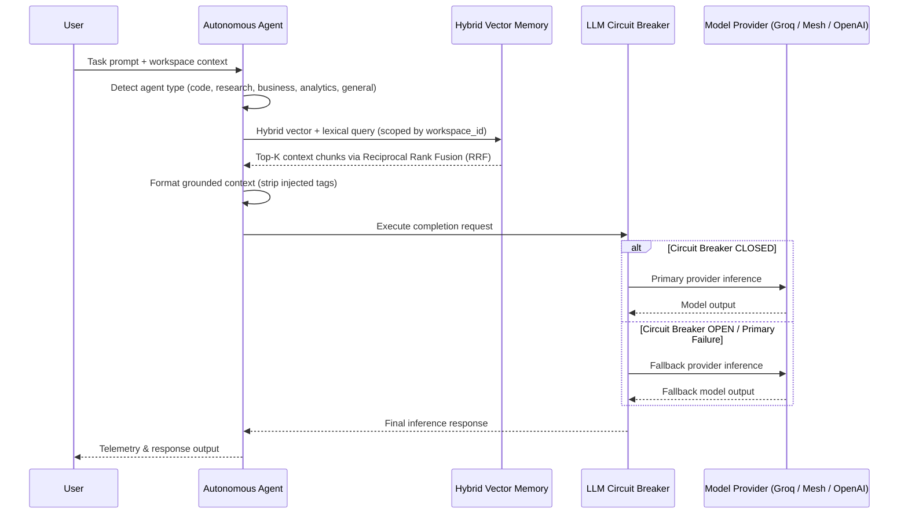

# Multi-Agent Engine & Autonomous Routing

Cognify provides an autonomous agent routing architecture designed to classify, contextualize, and execute tasks across specialized domain agents with hybrid vector memory retrieval and provider circuit breakers.

---

## Agent Execution Flow

---

## Specialized Agent Personas

Specialized agents inherit from a unified base interface (`base.agent.ts`) with custom system prompts and domain constraints:

| Agent | Source Path | Specialty |
| :--- | :--- | :--- |
| **Code Agent** | `server/src/services/ai/agents/specialized/code.agent.ts` | Software architecture, TypeScript/Python implementation, database query optimization, security reviews, and refactoring. |
| **Research Agent** | `server/src/services/ai/agents/specialized/research.agent.ts` | Technical literature review, competitive analysis, structured synthesis, and comparative evaluations. |
| **Business Agent** | `server/src/services/ai/agents/specialized/business.agent.ts` | Operational analysis, pricing models, SaaS metrics, and business process modeling. |
| **Analytics Agent** | `server/src/services/ai/agents/specialized/analytics.agent.ts` | KPI aggregation, metric extraction, data synthesis, and trend detection. |

---

## Hybrid Retrieval-Augmented Generation (RAG)

1. **Document Ingestion**: Files uploaded via `/api/files` are parsed (`fileParser.service.ts`) and enqueued to the dedicated `doc-ingest` queue.
2. **Chunking & Embeddings**: Content chunks are embedded into 1536-dimensional vectors using OpenAI `text-embedding-3-small`.
3. **Hybrid Search & Reciprocal Rank Fusion**:
   - **Vector Similarity**: Cosine distance using `pgvector` HNSW index (`embedding <=> $1`).
   - **Lexical Search**: PostgreSQL full-text search using `to_tsvector` and `websearch_to_tsquery`.
   - **RRF Merging**: Scores are fused using $RRF(d) = \sum \frac{1}{60 + r_i(d)}$ to surface the most relevant chunks.
4. **Tenant Isolation**: Every SQL query strictly enforces `WHERE workspace_id = $1` at the database level, preventing cross-tenant leakage.
5. **Prompt Injection Boundary**: All retrieved context strings are sanitized to strip unescaped `<retrieved_context>` tags before inclusion in the system prompt.
