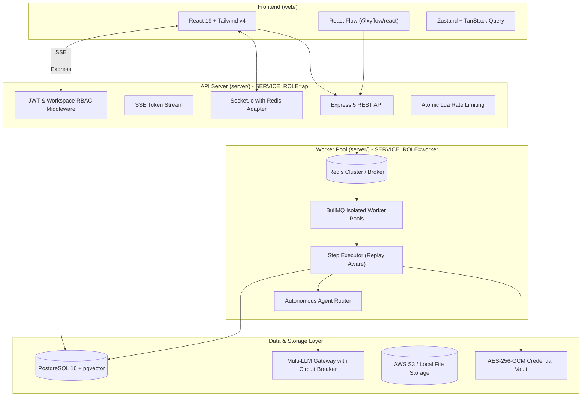

# Cognify Technical Architecture

Cognify is an AI operations and multi-agent workflow orchestration platform designed to build, execute, and monitor deterministic automation pipelines and autonomous agent systems.

---

## Core Subsystems

### 1. Web Application (`web/`)
* **Framework**: React 19, TypeScript, Vite.
* **Canvas Engine**: `@xyflow/react` (React Flow) paired with `dagre` layout algorithms for deterministic directed graph rendering.
* **UI Layer**: Tailwind CSS v4, Motion, Lucide icons, and Radix UI primitives.
* **State Management**: Zustand store, TanStack React Query, Axios client with bearer token interception.

### 2. Backend Server (`server/`)
* **Runtime**: Node.js, Express 5, TypeScript.
* **Process Roles (`SERVICE_ROLE`)**:
  * `all`: Runs API server, WebSockets, Redis subscribers, and BullMQ worker pools (default for local development).
  * `api`: Dedicated HTTP REST API, SSE endpoints, Socket.io server with Redis adapter fan-out, and Redis Pub/Sub run event subscriber.
  * `worker`: Headless BullMQ consumers with dedicated concurrency pools and a lightweight `/health` probe.
* **Rate Limiting**: Atomic Redis Lua token bucket sliding window (`rateLimiter.ts`) eliminating race conditions across horizontally scaled pods.
* **Observability**: Winston structured JSON logging and optional Sentry error tracking.

### 3. Database & Storage Layer (`database/`)
* **Relational Store**: PostgreSQL 16 managed via Prisma ORM (`database/schema.prisma`).
* **Vector & Lexical Search**: `pgvector` HNSW index (`embedding_hnsw_cosine_idx`) and PostgreSQL GIN full-text index (`embedding_content_gin_idx`) defined in `database/indexes.sql`.
* **Credential Vault**: AES-256-GCM envelope encryption with 12-byte random IV and 16-byte authentication tag (`server/src/services/security/vault.service.ts`).

### 4. Background Queues & Workers (`server/src/queues/`)
* **Queue Engine**: BullMQ backed by Redis.
* **Isolated Queues**:
  * `workflow-exec` (concurrency: 5): Processes DAG workflow runs with topological sorting, step-level replay skipping, and backpressure load shedding.
  * `doc-ingest` (concurrency: 2): Asynchronous file parsing, chunking, and vector embedding generation.
  * `ai-processing`: Background batch LLM tasks and offline processing.
* **Dead-Letter Queue (DLQ)**: Retries failed jobs up to 3 times with exponential backoff before persisting to dead-letter storage.
