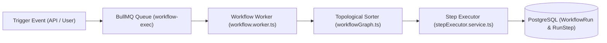

# Visual Workflows & Execution Engine

Cognify provides a visual canvas graph builder and an asynchronous execution engine for running multi-step automation pipelines.

---

## Workflow Graph Model

Workflows are modeled as directed acyclic graphs (DAGs) defined by **Nodes** and **Edges**:

* **Trigger Nodes**:
  * Manual execution
  * Webhook listener
  * Chat event

* **Deterministic Nodes**:
  * **Condition Node**: Evaluates logical operators (`contains`, `equals`, `gt`, `lt`) against step inputs.
  * **Transform Node**: Variable interpolation, template substitution, JSON parsing, and string case transformation.
  * **HTTP Node**: Arbitrary external HTTP requests with timeout enforcement and JSON body interpolation.

* **Agentic Nodes**:
  * LLM generation with specialized agents (Code, Research, Business, Analytics).
  * Structured JSON schema validation with automatic repair retry loops.

* **Action Nodes**:
  * Slack message delivery via bot token.
  * Notion page creation.
  * Google Sheets row appending.

---

## Asynchronous Execution Engine

When a workflow run is triggered:

1. **Topological Ordering**: The execution order of nodes is resolved using Kahn's topological sort algorithm (`WorkflowGraph.topologicalSort`), guaranteeing parents run before children regardless of canvas array ordering.
2. **Step-Level Replay**: In-progress runs persist granular `RunStep` records (`PENDING -> RUNNING -> COMPLETED | SKIPPED | FAILED`). When a run is retried from a failed node, upstream completed steps are marked `SKIPPED` and their cached outputs are reused without re-invoking LLM providers.
3. **Realtime Telemetry**: During execution, the worker pushes node status events (`step_start`, `step_complete`, `step_failed`) to Redis Pub/Sub, which fans out to connected clients in the `run:<runId>` Socket.io room with monotonic sequence numbers.
4. **Failure & Dead-Letter Handling**: Exceptions mark the current step and workflow run as `FAILED`. Failed jobs are retried up to 3 times before being moved to the dead-letter queue (`workflowDlq.ts`).
