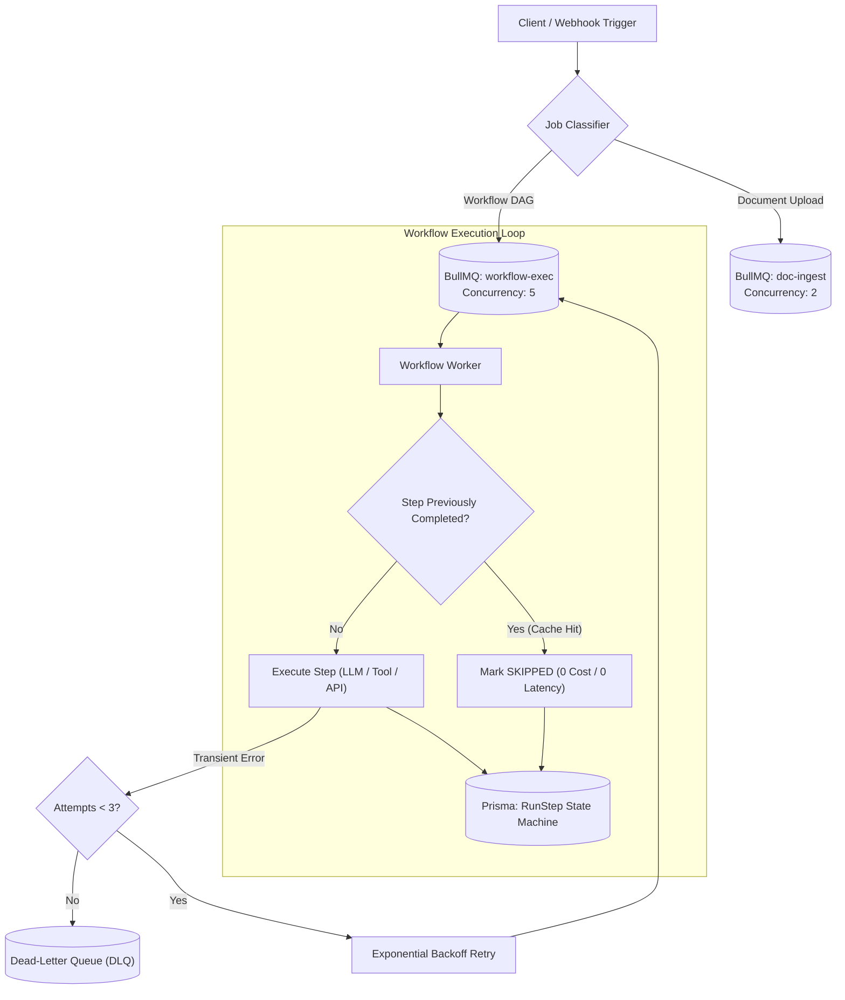

# ADR 001: Isolated BullMQ Queues and Step-Level Replay

## Status
**Accepted** (Implemented in Phase 3 / Phase 4)

## Context & Problem Statement
In Cognify, workloads span two vastly different operational profiles:
1. **Interactive Workflow Orchestration (`workflow-exec`)**: Multi-step acyclic DAGs executing agent routing, LLM inferences (latency 500ms–15s), conditional branching, and API webhooks.
2. **Heavy Document Ingestion (`doc-ingest`)**: PDF parsing, text extraction, recursive sliding-window chunking, and batch OpenAI text-embedding-3-small generation (latency 2s–60s).

### The Architectural Failure Mode of Shared Queues
Running these heterogeneous workloads through a unified Redis queue resulted in:
- **Head-of-Line Blocking**: Bulk document uploads (e.g., 50-page PDFs) saturated worker concurrency, starving real-time workflow runs.
- **Cascading Retry Waste**: If a 4-step workflow failed on step 4 (e.g. an external Slack webhook rate limit), standard queue retries would re-execute steps 1 through 3. Re-running upstream LLM steps consumed redundant tokens ($0.03–$0.12 per retry) and created duplicate external side effects.
- **Worker Starvation**: Unbounded queue depths prevented strict priority scheduling and dead-letter isolation.

## Considered Options
1. **Option A: Single Shared BullMQ Queue** — Simplest configuration, but introduces catastrophic head-of-line blocking and shared failure domains.
2. **Option B: Distributed FaaS / Serverless Temporal** — High operational complexity, cold-start latency spikes, vendor lock-in, and costly per-transition pricing.
3. **Option C: Dedicated BullMQ Queues (`workflow-exec` & `doc-ingest`) + Persistent `RunStep` State Machine** — Dedicated concurrency pools, isolated Redis streams, exponential backoff with Dead-Letter Queue (DLQ), and step-level caching.

## Decision
We adopted **Option C**:
- **Isolated Queues**:
  - `workflow-exec`: Concurrency = 5, dedicated to deterministic DAG traversal and agent calls.
  - `doc-ingest`: Concurrency = 2, dedicated to CPU-heavy parsing and rate-limited embedding batch calls.
- **Dead-Letter Handling (DLQ)**: Configured with 3 retry attempts, exponential backoff (`delay = 2000ms * 2^attempts`), and failure retention in Redis for post-mortem analysis.
- **Granular Step-Level Replay**:
  - Every step transition is persisted in PostgreSQL under `RunStep` (`PENDING -> RUNNING -> COMPLETED | FAILED | SKIPPED`).
  - When replaying or retrying a failed run from step $N$, the engine identifies previously completed steps ($1 \dots N-1$), marks them as `SKIPPED`, and hydrates downstream nodes with their cached `outputJson`.
  - Upstream LLM inferences are completely bypassed, preventing duplicate credit deductions and eliminating extraneous external side effects.

## Consequences

### Positive
- **Deterministic Latency Isolation**: Document uploads can no longer saturate or degrade execution speeds of critical user workflows.
- **Cost Reduction on Retries**: Step replay slashes token expenditure by over 75% on transient network failures during long multi-step pipelines.
- **Full Operational Auditability**: Step latencies, token counts, and input/output JSON blobs are immutably preserved per node attempt in `run_steps`.

### Negative & Mitigations
- **Redis Connection Overhead**: Two BullMQ queue instances require separate connection handles in `server/src/config/redis.ts`. *Mitigated by connection pooling.*
- **State Synchronization Complexity**: Step outputs must be strictly serialized as valid JSON. *Enforced by Zod schemas and automatic repair prompts in `stepExecutor.service.ts`.*
