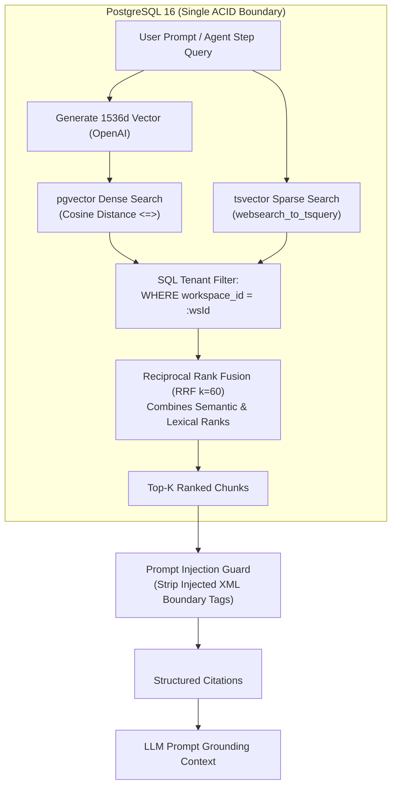

# ADR 002: PostgreSQL pgvector + tsvector Hybrid RAG with SQL Tenant Isolation

## Status
**Accepted** (Implemented in Phase 2 / Phase 3)

## Context & Problem Statement
Cognify is a multi-tenant AI operations platform where users upload proprietary technical documents (PDFs, CSVs, markdown specs) and query them via agent pipelines.

### Requirements
1. **Strict Multi-Tenant Isolation**: Zero cross-workspace data leakage. A query executed in Workspace A must never retrieve chunks from Workspace B under any circumstance.
2. **Hybrid Retrieval**: Semantic vector embeddings excel at conceptual queries ("how does rate limiting work?"), but fail on exact identifiers, function names, and error codes (`P2002`, `ERR_AUTH_EXPIRED`). Full-text keyword search is essential.
3. **Operational Simplicity**: Minimize the distributed systems surface area, avoid dual-write synchronization bugs, and leverage existing database replication and ACID transactions.

## Considered Options
1. **Option A: External Dedicated Vector DB (Pinecone / Qdrant / Weaviate)**
   - *Pros*: Built-in vector indexing algorithms.
   - *Cons*: Multi-tenancy is often implemented via namespace hacks or metadata filtering prone to silent software bugs. Introduces dual-write race conditions (PostgreSQL record committed, external vector write fails), separate billing, additional network roundtrips (30–80ms), and disjointed backup/restore lifecycles.
2. **Option B: Pure In-Memory Cosine Search in Node.js**
   - *Pros*: No database extension required.
   - *Cons*: $O(N)$ brute-force scans require loading millions of float vectors into Node memory, blowing past heap limits and degrading garbage collection.
3. **Option C: Unified PostgreSQL with `pgvector` + `tsvector` and Reciprocal Rank Fusion (RRF)**
   - *Pros*: Native HNSW/IVFFlat index in the primary relational database. Strict SQL-level filtering (`WHERE workspace_id = $1`). Reciprocal Rank Fusion combines sparse and dense search in a single atomic SQL query. Single ACID transaction boundary.

## Decision
We adopted **Option C**:
- **Co-located Storage**: Vector embeddings (1536-dimensional via `text-embedding-3-small`) and document metadata reside in the `embeddings` table alongside `File` and `Workspace` entities.
- **SQL-Enforced Multi-Tenancy**: All retrieval queries enforce `WHERE workspace_id = $workspaceId` at the SQL query planner level. Cross-tenant leakage is mathematically impossible without breaking PostgreSQL row visibility.
- **Hybrid Search via Reciprocal Rank Fusion (RRF)**:
  - Dense search evaluates cosine distance using the `pgvector` operator `<=>`.
  - Sparse search evaluates lexical BM25-equivalent relevance using `tsvector` and `websearch_to_tsquery('english', query)`.
  - Both result sets are joined in PostgreSQL and ranked via RRF formula with constant $k=60$:
    $$\text{RRF Score} = \frac{1}{60 + \text{rank}_{\text{dense}}} + \frac{1}{60 + \text{rank}_{\text{sparse}}}$$
- **Prompt-Injection Defense**: Retrieved context chunks are sanitized to strip any spoofed boundary tags (`<retrieved_context>`, `</retrieved_context>`) and wrapped into structured `<citation id="X" source="...">` blocks with a non-override system grounding directive.

## Consequences

### Positive
- **Guaranteed Tenant Isolation**: Workspace boundary check is embedded into the indexed relational query.
- **Zero Synchronization Drift**: When a document or workspace is deleted, PostgreSQL `ON DELETE CASCADE` instantly purges vectors without orphaned artifacts in external services.
- **High Recall & Precision**: Exact error codes (`P2002`) and natural language semantics are retrieved with equal accuracy.
- **Lower Infrastructure Costs**: No external vector DB subscriptions or egress bandwidth charges.

### Negative & Mitigations
- **Postgres Memory Usage**: The `pgvector` HNSW index requires adequate shared buffers. *Mitigated by indexing with `m = 16, ef_construction = 64` and sizing PostgreSQL container memory to 2GB+ in production.*
