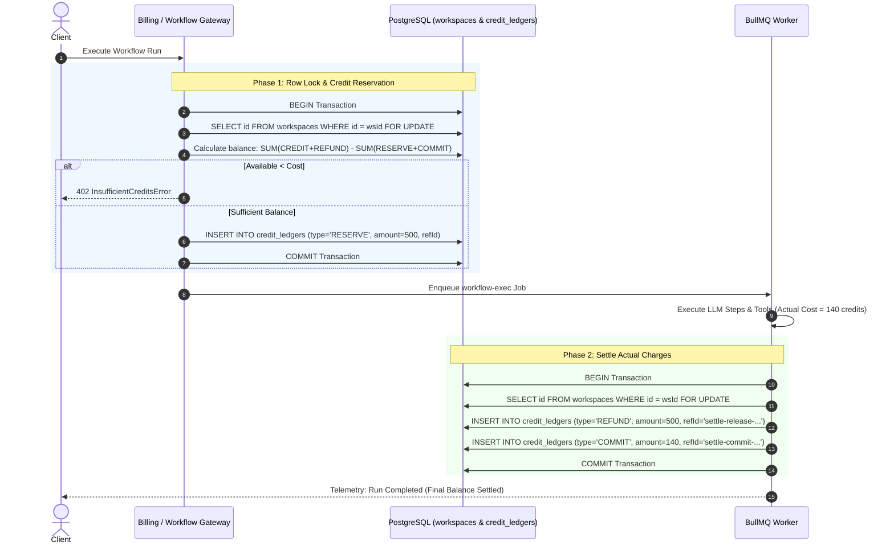

# ADR 003: Append-Only Credit Ledger with Row Locks and P2002 Webhook Idempotency

## Status
**Accepted** (Implemented in Phase 4)

## Context & Problem Statement
Cognify monetizes multi-agent runs through a credit quota model. Workflows consume credits proportional to token consumption (input/output LLM tokens) and third-party API dispatches.

### Vulnerabilities of Mutable Counters
Traditional SaaS architectures often track balances using a mutable column:
```sql
UPDATE workspaces SET balance = balance - :cost WHERE id = :workspaceId;
```
In high-throughput agent orchestration, mutable counters present fatal vulnerabilities:
1. **Concurrency Race Conditions**: Two parallel workflow runs executing simultaneously read identical balance state, causing lost updates and overdrafting past zero.
2. **Double-Spend on Webhooks**: Payment providers (Stripe, Razorpay) deliver webhooks with at-least-once semantics. Network retries frequently trigger duplicate credit allocations if the handler lacks atomic deduplication.
3. **Audit Trail Inability**: If a user contests billing, an in-place counter cannot explain historical balance progression without external event sourcing.

## Considered Options
1. **Option A: Mutable Balance Column with Optimistic Locking (`version` column)**
   - High abort/retry rates under concurrent agent executions; still requires a separate historical ledger for auditing.
2. **Option B: Redis In-Memory Counter with Eventual DB Sync**
   - High performance, but risks balance loss on Redis restarts and distributed desynchronization with PostgreSQL.
3. **Option C: Append-Only `CreditLedger` with Row-Level Locking (`SELECT ... FOR UPDATE`) & P2002 Idempotency**
   - Immutable accounting ledger. Four discrete ledger entry types (`CREDIT`, `RESERVE`, `COMMIT`, `REFUND`). Strict row-level pessimistic locking on the parent workspace record during reservation and settlement. Database-level unique constraint deduplication on webhook arrivals.

## Decision
We adopted **Option C**:

### 1. Mathematical Balance Derivation
Balance is never mutated; it is mathematically derived by aggregating immutable entries:
$$\text{Available Balance} = \sum (\text{CREDIT} + \text{REFUND}) - \sum (\text{RESERVE} + \text{COMMIT})$$

### 2. Two-Phase Execution Lock (Hold & Settle)
- **Phase 1: Reserve Hold**: Before a workflow run dispatches to BullMQ, an interactive transaction locks the workspace row:
  ```sql
  SELECT id FROM workspaces WHERE id = :workspaceId FOR UPDATE;
  ```
  It validates that $\text{Available Balance} \ge \text{Max Estimated Run Cost}$, and inserts a `RESERVE` entry. If credits are insufficient, it immediately throws a typed `402 Payment Required` (`InsufficientCreditsError`).
- **Phase 2: Settle**: Upon run completion, the reservation hold is atomically released (`REFUND` of hold amount) and the actual token cost is committed (`COMMIT` of actual used amount). If the run failed before LLM invocation, a full `REFUND` is issued.

### 3. Webhook Deduplication via PostgreSQL P2002 Violations
- Inbound webhooks from Stripe and Razorpay are checked against the `webhook_events` table with a unique constraint on `external_event_id`.
- Handlers attempt to insert the incoming event inside a raw database call. If the external ID exists, PostgreSQL raises a `P2002` unique constraint violation.
- The service catches `P2002` and immediately responds with `200 OK` (`deduplicated: true`), preventing duplicate credit grants while satisfying payment gateway retry contracts.



## Consequences

### Positive
- **Mathematical Drift-Free Accounting**: Impossible to lose updates or enter invalid negative balances.
- **Zero Double-Billing**: P2002 unique constraint enforcement ensures duplicate webhook retries are harmless.
- **Auditable Financial Trail**: Every token expenditure maps 1:1 to a specific `run_id` and timestamp.

### Negative & Mitigations
- **Lock Contention Under Extreme Concurrency**: `FOR UPDATE` serializes operations on the same workspace. *Mitigated by scoping the row lock exclusively to the short transaction window (~5–10ms) during balance check and reservation, releasing the lock before the long-running LLM inference begins.*
